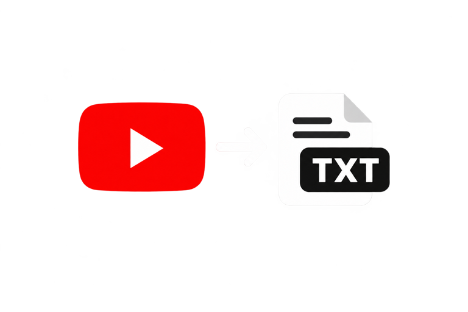

<p align="center">
  
</p>

<h1 align="center">yt-transcript</h1>

<p align="center">
  Transcreve vídeos do YouTube para texto e deixa o seu agente de IA analisar.<br>
  IA local (whisper.cpp), sem GPU, sem enviar áudio para nenhum serviço. Linux, macOS e Windows.
</p>

---

**Como funciona:**

1. Se o vídeo tem legenda no idioma original (manual ou automática), usa ela. Leva uns 3 segundos.
2. Se não tem, baixa o áudio e transcreve com o Whisper no seu computador. Num notebook de 4 núcleos, roda ~8x mais rápido que a duração do vídeo.
3. Com um agente de IA, o [`AGENTS.md`](AGENTS.md) ensina o agente a transformar a transcrição em relatório: resumo, insights, citações com link para o tempo exato e checagem de fatos com pesquisa na web.

## Instalação

Passos comuns aos três sistemas:

```bash
git clone https://github.com/DevLeonardoK/yt-transcript.git
cd yt-transcript
```

### Linux

```bash
# dependências (Debian/Ubuntu; em outras distros use dnf/pacman)
sudo apt install ffmpeg git gcc g++ make cmake
pipx install "yt-dlp[default]"        # o yt-dlp do apt fica desatualizado
# Go 1.27+: https://go.dev/dl

make                                   # compila o whisper.cpp e a ferramenta
bin/yt-transcript setup                # confere tudo e baixa os modelos
make install                           # opcional: deixa `yt-transcript` disponível em qualquer pasta
```

### macOS

```bash
brew install go yt-dlp ffmpeg whisper-cpp

make build
bin/yt-transcript setup
make install                           # opcional
```

### Windows

No PowerShell:

```powershell
winget install GoLang.Go yt-dlp.yt-dlp Gyan.FFmpeg Git.Git
# feche e abra o terminal para atualizar o PATH

go build -o bin\yt-transcript.exe .
bin\yt-transcript.exe setup            # baixa o whisper.cpp oficial (com hash conferido) e os modelos
```

O `setup` mostra o que está faltando e o comando para instalar. Modelos e o whisper baixado ficam em `~/.cache/yt-transcript` (Linux), `~/Library/Caches/yt-transcript` (macOS) ou `%LocalAppData%\yt-transcript` (Windows).

## Uso direto

```bash
yt-transcript "https://www.youtube.com/watch?v=ID"            # salva "<título> [ID].txt" na pasta atual
yt-transcript -srt -o transcricoes URL1 URL2 URL3             # vários vídeos em paralelo + legenda .srt
yt-transcript -force-ai URL                                   # ignora a legenda do YouTube, usa só a IA
yt-transcript -lang en URL                                    # força o idioma
yt-transcript -model small -beam 1 URL                        # mais preciso (modelo baixado na hora)
```

| Opção | Padrão | O que faz |
|---|---|---|
| `-o` | `.` | pasta de saída |
| `-srt` | desligado | também gera `.srt` (com tempos) |
| `-model` | `base` | `tiny`, `base`, `small`, `medium`, `large-v3-turbo-q5_0` ou caminho de um `.bin` |
| `-j` | `2` | vídeos em paralelo (a IA local roda um por vez) |
| `-threads` | núcleos físicos | threads do whisper |
| `-beam` | `5` | `1` = busca gulosa, mais rápida |
| `-no-vad` | desligado | transcreve também os silêncios |
| `-v` | desligado | mostra a saída do yt-dlp, ffmpeg e whisper |

Os caminhos dos arquivos gerados saem no **stdout**, um por linha, e o progresso vai para o stderr. Isso facilita usar em scripts: `yt-transcript URL | xargs cat`. Ctrl+C encerra tudo e apaga os temporários.

## Usando com um agente de IA

A ideia: você manda o link e o agente faz o resto. Ele transcreve, lê tudo, pesquisa e entrega um relatório em `analises/`.

### 1. Abra o agente na pasta do projeto

O agente precisa estar dentro da pasta `yt-transcript`. As instruções ficam no [`AGENTS.md`](AGENTS.md), o padrão aberto lido pela maioria dos agentes.

| Agente | Como abrir |
|---|---|
| [Claude Code](https://claude.com/claude-code) | `cd yt-transcript && claude` |
| [Codex CLI](https://github.com/openai/codex) | `cd yt-transcript && codex` |
| [Gemini CLI](https://github.com/google-gemini/gemini-cli) | `cd yt-transcript && gemini` |
| Cursor / VS Code + Copilot / Windsurf | abra a pasta no editor e use o chat do agente |
| Outro | abra o agente na pasta |

Se o seu agente não carregar o `AGENTS.md` sozinho, comece a conversa com: *"Leia o AGENTS.md e siga as instruções."*

Para resultados melhores, use um agente com **busca na web** ligada: é ela que permite checar as afirmações do vídeo.

### 2. Peça o que quiser

```text
Analisa esse vídeo: https://www.youtube.com/watch?v=ID
```

```text
Resume em 5 pontos: https://youtu.be/ID
```

```text
O que ele fala sobre investimento em renda fixa? Me dá os trechos com tempo.
https://www.youtube.com/watch?v=ID
```

```text
Compara esses três vídeos sobre jejum intermitente. Onde concordam, onde
discordam e quem tem mais respaldo científico?
URL1 URL2 URL3
```

```text
Checa os fatos desse vídeo, com fontes: https://www.youtube.com/watch?v=ID
```

### 3. O que você recebe

- `transcricoes/<título> [ID].txt` e `.srt`: o texto completo e as legendas com tempo.
- `analises/<título> [ID].md`: o relatório, com TL;DR, estrutura do vídeo com links para cada parte, pontos principais, insights, citações, tabela de afirmações checadas (✅ ⚠️ ❌ ❓) com fontes, conceitos citados, pesquisa complementar e perguntas em aberto.

O modelo do relatório e as regras (não inventar citações, separar o que o vídeo diz do que o agente conclui, citar fontes) estão no [`AGENTS.md`](AGENTS.md). Edite o arquivo para mudar o formato do relatório.

## Desempenho

Medido num i5-1135G7 (4 núcleos / 8 threads) com um TEDx em português de 14,5 min. A qualidade é a taxa de erro de palavras (WER) contra a legenda manual do vídeo.

| | Versão inicial | Atual |
|---|---|---|
| Com legenda do YouTube | 4,0 s | 2,8 s |
| Sem legenda (IA local, `base`) | 188 s, WER 12,5% | 104 s, WER 12,6% |
| 4 vídeos com legenda | 11,6 s | 5,1 s |

O que fez diferença:

- **Threads = núcleos físicos.** O whisper com hyperthreads ficou ~2x mais lento e instável (8 threads: 50–95 s; 4 threads: 43–48 s num trecho de 5 min). A detecção funciona em Linux, macOS e Windows.
- **VAD (Silero).** Pula os silêncios: ~20% mais rápido e com menos erros, porque o Whisper não "inventa" texto no silêncio.
- **Uma leitura da página.** Os metadados vêm uma vez só (`yt-dlp -J`), e as chamadas seguintes usam `--load-info-json`. Isso economiza ~1,4 s por vídeo.
- **Download → ffmpeg por pipe.** A conversão para 16 kHz acontece durante o download, e o áudio original não vai para o disco.
- **Paralelismo controlado.** Downloads e legendas de vários vídeos rodam juntos, e a IA roda um vídeo por vez (ela já usa todos os núcleos).

Testado e descartado, porque piorou a qualidade: áudio de 50 kbps (WER 11,1% contra 9,8%), modelo `base` quantizado q5_1 (10,6–13%) e busca gulosa no `base` (13,8%). No modelo `small` a busca gulosa não perde qualidade (WER 6,8%, contra 9,2% do `base`): use `-model small -beam 1` quando a precisão importar mais.

A memória é dominada pelo whisper (~500 MB com `base`). O processo Go usa poucos MB, e o parser de legendas processa 1 h de legenda automática em ~2,7 ms.

## Desenvolvimento

```bash
make build    # binário estático em bin/
make lint     # go vet + go fix
```

Go 1.27+, só biblioteca padrão. O CI compila e roda o `go vet` em Linux, macOS e Windows. Convenções e regras para contribuir (inclusive para agentes de IA) estão na parte 2 do [`AGENTS.md`](AGENTS.md).

## Observações

- Traduções automáticas do YouTube são ignoradas. Só vale a legenda no idioma original do vídeo; fora isso, entra a IA.
- Use para conteúdo que você tem direito de acessar e respeite os termos do YouTube e os direitos dos autores.
- Programas empacotados pelo Nix podem exportar `LD_LIBRARY_PATH` com bibliotecas do Nix, o que quebra o `ffmpeg` do sistema. A ferramenta remove esses caminhos só nos processos que ela chama.

## Licença

[MIT](LICENSE)
